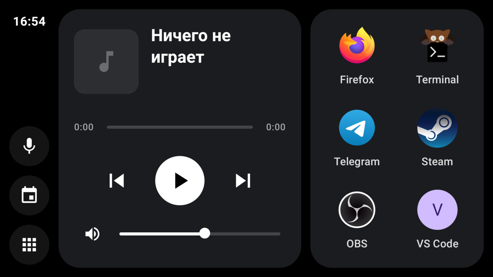
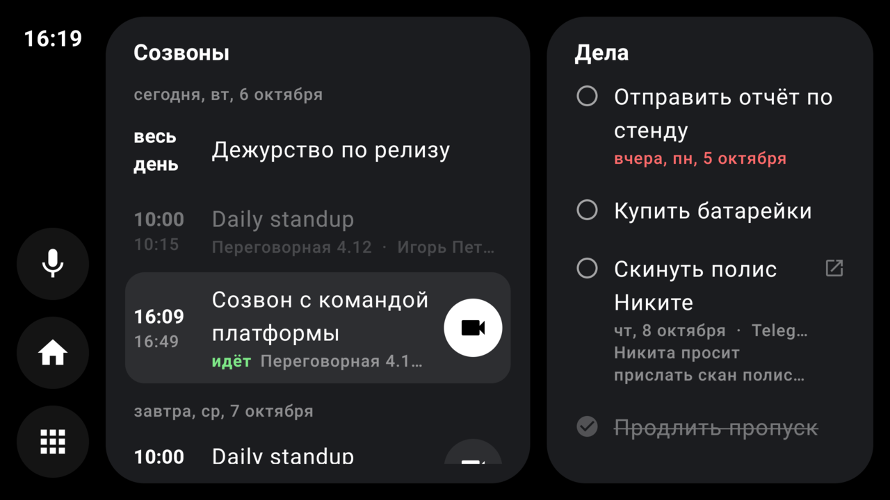
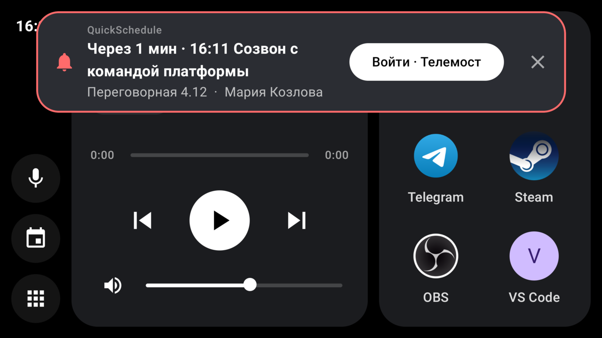

# AndroDeck

Старый Android-телефон как пульт для Linux-компьютера — в духе Android Auto: плеер, громкость, микрофон, запуск приложений, расписание и уведомления. Телефон стоит рядом с монитором и работает по USB (через ADB) или по Wi-Fi.



| | |
|---|---|
|  |  |

## Что умеет

- **Плеер** — то, что играет на компьютере (MPRIS через `playerctl`): обложка, перемотка, пауза, следующий и предыдущий трек.
- **Звук** — громкость и выключение звука, отдельная кнопка выключения микрофона (PipeWire, `wpctl`).
- **Быстрые приложения** — свой список в конфиге, плитки занимают карточку целиком.
- **Все приложения** — всё, что есть в меню компьютера (`.desktop`), с иконками.
- **Расписание** — созвоны на неделю и дела; присылает [QuickSchedule](https://github.com/delarun/QuickSchedule) или любая программа по HTTP. Кнопка «Войти» открывает созвон на компьютере, кружок у дела отмечает его выполненным.
- **Уведомления** — баннер со звуком и кнопкой действия, а когда Deck не на экране — обычное уведомление Android; тоже от QuickSchedule или от чего угодно по HTTP.
- **Связь по ADB** — сервер сам пробрасывает порт на подключённый телефон (`adb reverse`), адрес в приложении вводить не нужно.

## Как устроено

```
телефон (приложение Deck)  ⇄  deckd на компьютере  →  playerctl, wpctl, приложения, xdg-open
        HTTP + WebSocket            ↑
                              QuickSchedule и другие: POST /schedule, POST /notify
```

- [`server/deckd.py`](server/deckd.py) — сервер на FastAPI, один файл;
- [`app/`](app/) — приложение на Kotlin и Jetpack Compose.

## Требования

- **Компьютер**: Linux с PipeWire (`wpctl`), `playerctl`, `xdg-open`; Python 3.10+; `adb` — если связь по ADB.
- **Телефон**: Android 8.0 и новее. Проверено на Galaxy S6 edge (Android 11), экран в альбомной ориентации.
- **Сборка приложения**: JDK 21 и Android SDK 35.

## Сервер

```sh
cd server
python3 -m venv .venv
.venv/bin/pip install -r requirements.txt
mkdir -p ~/.config/deckd
cp config.example.yaml ~/.config/deckd/config.yaml   # и поменять token
.venv/bin/python deckd.py
```

Другой путь к конфигу — переменная `DECK_CONFIG`.

### Конфиг

| Ключ | По умолчанию | Смысл |
|---|---|---|
| `token` | `""` | общий секрет с приложением и с программами, которые присылают расписание. Пусто — без проверки |
| `listen`, `port` | `0.0.0.0`, `8765` | где слушать. Только ADB — хватит `127.0.0.1`; Wi-Fi — `0.0.0.0` |
| `adb` | `false` | держать `adb reverse` на подключённых устройствах (USB или беспроводная отладка) |
| `players` | `%any` | приоритет плееров для `playerctl`: `"spotify,mpv,firefox,%any"` |
| `apps` | `[]` | быстрые приложения: `id`, `name`, `icon` (имя иконки, как `Icon=` в `.desktop`, или путь к файлу), `cmd` |
| `open_schemes` | `[http, https, tg]` | какие ссылки из расписания и уведомлений можно открывать на компьютере |

### Автозапуск

`~/.config/systemd/user/deckd.service` (пути — свои):

```ini
[Unit]
Description=deckd — Android deck backend
After=graphical-session.target
PartOf=graphical-session.target

[Service]
ExecStart=%h/путь/к/AndroDeck/server/.venv/bin/python %h/путь/к/AndroDeck/server/deckd.py
Environment=PYTHONUNBUFFERED=1
# приложения, запущенные с телефона, не должны умирать вместе с deckd при его перезапуске
KillMode=process
Restart=on-failure
RestartSec=2

[Install]
WantedBy=graphical-session.target
```

```sh
systemctl --user enable --now deckd
```

## Приложение

```sh
./gradlew assembleRelease
adb install -r app/build/outputs/apk/release/app-release.apk
```

- Ставить нужно release-сборку: debug на старом телефоне заметно тормозит. Она подписана отладочным ключом — для установки по ADB этого достаточно.
- На слабом телефоне помогает компиляция на устройстве; она сбрасывается при каждой переустановке:

  ```sh
  adb shell cmd package compile -m speed -f org.evileat.deck
  ```

- Deck объявляет себя лаунчером, поэтому его можно сделать домашним экраном — тогда он открывается сам после перезагрузки. Не нужно — убери категорию `HOME` из [`AndroidManifest.xml`](app/src/main/AndroidManifest.xml).

### Настройка на телефоне

Тап тремя пальцами в любом месте открывает настройки: адрес сервера и токен.

- **По ADB** (`adb: true` в конфиге сервера): достаточно токена. Приложение само сначала пробует `127.0.0.1` с портом из адреса и только потом — сам адрес.
- **По Wi-Fi**: адрес вида `http://192.168.1.10:8765`.

### В фоне

Связь с компьютером держит фоновая служба, поэтому в шторке всегда висит «Deck на связи с компьютером». Пока Deck на экране, уведомления с компьютера показываются баннером; свернул его или открыл другое приложение — приходят обычными уведомлениями Android, с той же кнопкой действия. На Android 13 и новее при первом запуске нужно разрешить уведомления.

### Экран

Слева — бар: часы, микрофон, расписание, все приложения. Повторное нажатие на кнопку страницы возвращает на дашборд. Нет связи с сервером — под часами красный значок.

## Расписание и уведомления из QuickSchedule

В `config.toml` у QuickSchedule:

```toml
[deck]
url   = "http://127.0.0.1:8765"
token = "тот же, что у deckd"
```

После этого на телефоне появляются созвоны и дела, а напоминания о созвонах приходят баннером. Дело, отмеченное на телефоне, отмечается и в QuickSchedule (`edit = false` в `[deck]` — только смотреть). Проверить — `quickschedule --test-notify`.

## HTTP API

Токен — параметром `?t=` или заголовком `X-Token`.

| Запрос | Что делает |
|---|---|
| `GET /ws` (WebSocket) | состояние плеера и звука при каждом изменении; события `schedule` и `notify` |
| `POST /player/{play-pause,next,previous}`, `POST /player/seek?pos=` | управление плеером |
| `POST /volume?v=0..1`, `POST /mute`, `POST /mic-mute` | громкость, звук, микрофон |
| `GET /apps`, `POST /launch/{id}` | быстрые приложения |
| `GET /desktop`, `POST /desktop/launch/{id}` | все приложения из `.desktop` |
| `POST /notify` | показать уведомление на телефоне |
| `POST /schedule`, `GET /schedule` | прислать и прочитать расписание |
| `POST /schedule/task/{id}?done=true` | телефон: отметить дело; само дело меняет источник расписания |
| `GET /schedule/actions?wait=25` | для источника расписания: что нажали на телефоне (длинный опрос) |

Уведомление из любого скрипта:

```sh
curl -X POST http://127.0.0.1:8765/notify -H 'X-Token: …' -H 'Content-Type: application/json' \
  -d '{"app": "backup", "title": "Бэкап готов", "body": "42 ГБ за 12 минут", "ttl": 30}'
```

Поля: `title`, `body`, `app`, `urgent`, `ttl` — сколько секунд держать на экране (5–600), `url` и `label` — кнопка, которая откроет ссылку на компьютере.

Расписание — `{"data": …, "links": {ключ: ссылка}}`. `data` уходит на телефон как есть, `links` остаются на компьютере: телефон присылает только ключ. Формат `data` — в [`DeckClient.kt`](app/src/main/java/org/evileat/deck/DeckClient.kt) (`parseSchedule`). Источник должен повторять отправку хотя бы раз в три минуты, иначе расписание на телефоне гаснет.

## Безопасность

- Всё идёт по обычному HTTP, токен — открытым текстом. Это для домашней сети или для USB.
- Знающий токен может запустить любое приложение из меню компьютера и открыть на нём ссылку. Если телефон подключён по ADB, оставь `listen: 127.0.0.1` — тогда сервер недоступен из сети вовсе.

## Дальше

Идеи и планы — в [BACKLOG.md](BACKLOG.md).

## Лицензия

[MIT](LICENSE)
